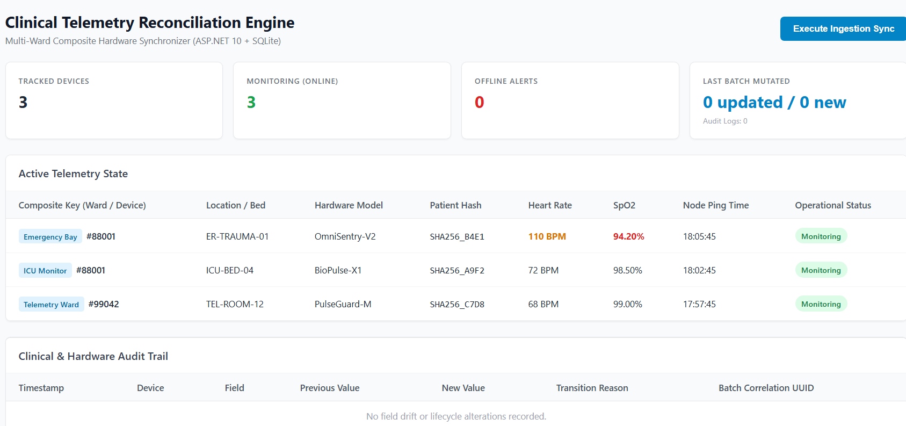

# 🏥 Medical Telemetry Sync: Hospital Monitor Dashboard

Think of a hospital like a big school with different classrooms—like the **Emergency Room (ER)**, the **Intensive Care Unit (ICU)**, and regular hospital rooms. 

In every room, little computer boxes watch patients' heartbeats and breathing. Sometimes two machines in different rooms have the exact same number tag (like two kids in different classes named "Alex"). This project acts like a super-smart helper that makes sure no patient's numbers ever get mixed up!

---

## 📸 The Dashboard Screen Explained (Like You're 10 Years Old!)

Here is what you see when you look at the screen:

---

### 1. The Big Scorecards at the Top
Just like the scoreboard in a gym, these cards tell doctors what is happening in one second:

* 🏷️ **TRACKED DEVICES (`3`)**: The computer is watching 3 machines right now.
* 🟢 **MONITORING (ONLINE) (`3`)**: All 3 machines are plugged in, working, and sending numbers.
* 🔴 **OFFLINE ALERTS (`0`)**: Zero machines are lost or unplugged! Everything is safe.
* 🔄 **LAST BATCH MUTATED (`0 updated / 0 new`)**: We just asked the computer to check for changes. Because the numbers were identical to a second ago, the smart computer did not write down unnecessary duplicate notes! (Doctors call this *Idempotency*).

---

### 2. The Active Telemetry State Table (Who is in Which Bed?)

This table shows the real patients and their heart numbers:

| Column Name | What It Means | Why It Matters on the Screen |
| :--- | :--- | :--- |
| **Composite Key (Ward / Device)** | The room name plus the machine's ID badge number. | Look closely: There is an **Emergency Bay #88001** and an **ICU Monitor #88001**! Because we check the room name too, they never get mixed up. |
| **Location / Bed** | Which exact bed the patient is resting on. | Shows beds like `ER-TRAUMA-01` or `ICU-BED-04`. |
| **Hardware Model** | The brand of the monitor machine. | Like `BioPulse-X1` or `OmniSentry-V2`. |
| **Patient Hash** | A secret scrambled code for the patient's name. | Keeps patients' private names safe and hidden. |
| **Heart Rate** | How fast the heart is beating (BPM). | The top patient has **110 BPM** colored in **Orange/Amber** because their heart is beating fast! The others are resting at 72 and 68. |
| **SpO2** | How much oxygen is in their blood. | The top patient has **94.20%** colored in **Red** so nurses know to help them breathe right away! |
| **Node Ping Time** | The exact second the machine said "I'm here!" | Tells us the signal is fresh and current. |
| **Operational Status** | Green "Monitoring" pill badge. | Means the computer has an active connection. |

---

### 3. The Blue Action Button: `[Execute Ingestion Sync]`
* Located in the top right corner.
* When you click it, the app asks the hospital network: *"Give me the latest numbers right now!"*
* If a patient's heart rate changes, or if a machine gets unplugged, the screen updates instantly.

---

### 4. Clinical & Hardware Audit Trail (The Hospital Diary)
* At the bottom, there is an official diary table.
* In this picture, it says: *"No field drift or lifecycle alterations recorded."*
* **Why is it empty?** Because no vitals changed yet! But the moment someone's heart changes or a bed moves, this table writes an un-erasable diary note showing what the number was before, what it changed to, and what time it happened.

---

## 🚀 How to Run It on Your Computer

### What You Need Installed
* [.NET 10 SDK](https://dotnet.microsoft.com/)
* [Node.js](https://nodejs.org/) (Version 20 or newer)
* [Angular CLI](https://angular.dev/) (`npm install -g @angular/cli@19`)

